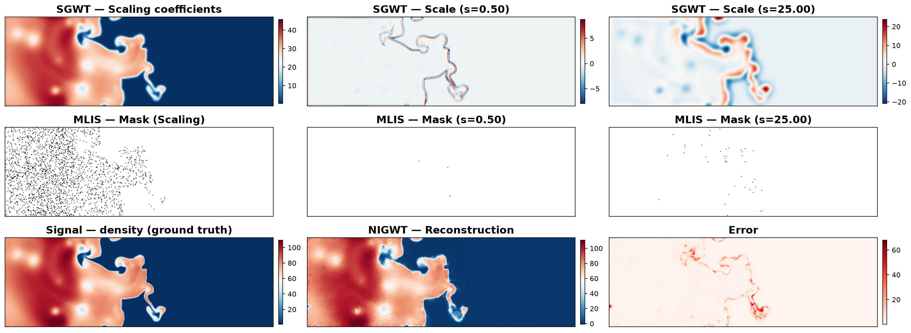

# Multilevel Graph Wavelet Compressed Sensing with Scale-Aware Neural Recovery


<sub>*Sample from the turbulent radiative layer 2D dataset in [The Well](https://github.com/PolymathicAI/the_well), compression ratio 5%. Row 1: SGWT coefficients (scaling, and the finest and coarsest bandpass scales). Row 2: the MLIS sampling mask for each of those scales. Row 3: ground-truth signal, NIGWT reconstruction, and error.*</sub>

Graph Wavelet Compressed Sensing (GWCS) is a method for compressing graph signal
datasets, including large-volume simulated PDEs over meshes. It is built on three modules:

- **SGWT** (Spectral Graph Wavelet Transform) `graph signal → dense wavelet coefficients`<br>
  Transforms node-domain signals into multiscale wavelet-domain representations. (row 1 above)
- **MLIS** (Multilevel Importance Sampling) `dense → sparse wavelet coefficients`<br>
  Given a target compression ratio, allocates a sampling budget per wavelet scale and samples within each scale by coefficient energy. (row 2 above)
- **NIGWT** (Neural Inverse Graph Wavelet Transform) `sparse wavelet coefficients → reconstructed graph signal`<br>
  Reconstructs the graph signal from the sparse coefficients using a learned model. (row 3 above)

## Setup

1. Clone the repository.

2. Install [uv](https://docs.astral.sh/uv/):

   ```bash
   curl -LsSf https://astral.sh/uv/install.sh | sh
   ```

3. Install dependencies:

   For CUDA machine:
   ```bash
   uv sync --extra gpu
   ```
   For CPU machine:
   ```bash
   uv sync --extra cpu
   ```

4. Optionally, run unit tests:

   ```bash
   uv run pytest
   ```

## Training GWCS

### Approximately Band-limited (ABL)

ABL data is synthetic and generated automatically on first run.

```bash
uv run python scripts/train_abl_gwcs.py
```

### Turbulent radiative layer 2D

Download the raw data first:

```bash
uv run python scripts/download_raw_data.py --dataset turbulent_radiative_layer_2D
```

Then train:

```bash
uv run python scripts/train_turbulent_gwcs.py
```

### Outputs

```
datasets/
├── ABL/                              # generated ABL data
└── turbulent_radiative_layer_2D/
    ├── raw/                          # downloaded HDF5 files
    └── processed/                    # preprocessed graphs

runs/
└── ABL_GWCS/<run_id>/                # example; turbulent_GWCS/<run_id>/ has the same layout
    ├── config.json                   # run metadata
    ├── train.log
    ├── checkpoint_best.pt
    ├── checkpoint_last.pt
    ├── history.json                  # per-epoch train/val loss
    ├── summary.json                  # final test metrics
    └── figs/                         # reconstruction figures
```

## Citation

If you find this code or our [paper](https://doi.org/10.1137/1.9781611979329.15) useful in your research, please cite:

```bibtex
@inproceedings{nouranizadeh2026multilevel,
  title={Multilevel Graph Wavelet Compressed Sensing with Scale-Aware Neural Recovery},
  author={Nouranizadeh, Amirhossein and Patil, Sarang and Varghese, Alan John and Narayanan, Varsha and Chakraborty, Amit and Xu, Mengjia},
  booktitle={Proceedings of the 2026 SIAM International Conference on Data Mining (SDM)},
  pages={192--210},
  year={2026},
  organization={SIAM}
}
```
